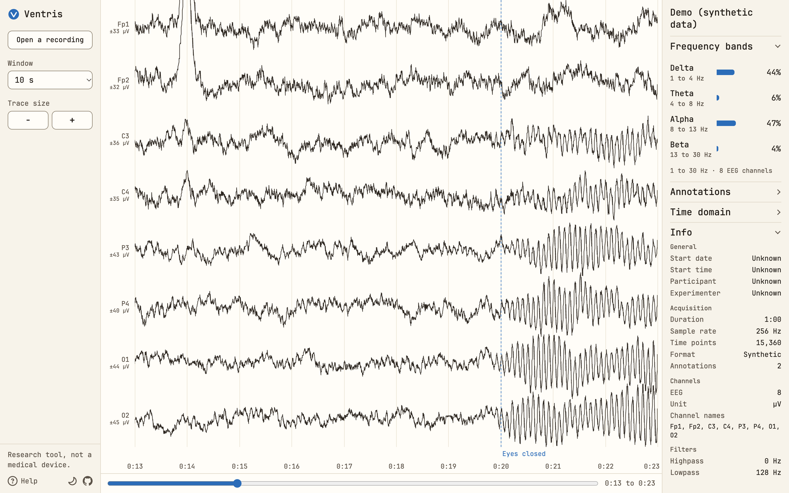

# Ventris

**Look inside an EEG recording in seconds, right in your browser.**

No install, no account and no upload. Your signals, frequency bands, annotations and header details, all on one screen.

**[Open Ventris](https://ventris-tools.github.io/ventris/)** and drop in an EDF file, or try the built-in demo.

[](https://ventris-tools.github.io/ventris/)

*The built-in demo, which is synthetic data. A blink shows in Fp1 and Fp2, and alpha builds at the back of the head when the eyes close at 0:20.*

## Why Ventris

Most EEG work starts with a simple question: what's in this file, and is it any good? Answering that shouldn't take a Python environment, a MATLAB license or a script.

- **Nothing to set up.** Ventris is a web page, so it works on any computer with a modern browser, including ones you can't install software on.
- **Your data stays with you.** Your browser reads the file on your own computer, and nothing is uploaded.
- **It fits your pipeline.** Ventris doesn't replace MNE-Python, EEGLAB or FieldTrip. It's the quick look before them, and its header fields follow MNE-Python's EDF reader, so the details usually match `mne.io.read_raw_edf`.
- **It's open source.** Ventris is free under the BSD 3-Clause license, and you can read every line of it.

## What it's good for

- **Checking a recording right after a session.** Spot flat channels, noisy channels and artifacts while you can still do something about them.
- **Opening a file you didn't record.** See the sample rate, channels, filter settings and duration of a shared or public dataset before you write any code.
- **Finding your events.** Jump between the annotations in an EDF+ file and check that they line up with the signal.
- **Teaching.** The demo shows a blink and eyes-closed alpha, with no data to find and nothing for students to install.

## What it shows

| View | What you get |
|---|---|
| Traces | Choose a window of 5 seconds or longer, and move through the recording with the slider, a swipe or the keyboard. Point at a trace to read the recorded value at that moment. |
| Frequency bands | The share of 1 to 30 Hz power in delta, theta, alpha and beta for the window on screen, from Welch spectra averaged across the EEG channels. It updates as you move. |
| Annotations | EDF+ annotations appear on the time axis. Select one in the list to jump to it. |
| Time domain | Mean, range and standard deviation across the whole recording, the channels with the lowest and highest SD, and a count of flat channels. |
| Recording details | Start time, participant, device, sample rates, channel names and filter settings from the header. EOG, EMG and ECG channels are read from their labels and stay out of the EEG measures. |

## Your recordings stay on your computer

EEG recordings are sensitive, so you shouldn't have to upload one just to look at it.

Everything in Ventris runs in your browser. The app has no code that sends a recording anywhere. The page's Content Security Policy backs this up by blocking `fetch`, XHR, WebSockets and loads from other hosts. It cannot stop navigation or WebRTC, so the promise rests on the code as well. You can watch your browser's network panel while a file opens, and read the code yourself.

## Run it locally

The hosted page is all most people need. You can also run your own copy, which needs no internet connection once it's downloaded. There's no build step and there are no runtime dependencies.

```bash
git clone https://github.com/ventris-tools/ventris.git
```

```bash
cd ventris
```

```bash
python3 -m http.server 4173
```

Then open <http://localhost:4173>.

## Where it stands

Ventris is an early preview, and today it's a viewer for EDF and EDF+ files:

- BDF files aren't supported yet.
- It doesn't filter, re-reference or export signals.
- The whole file is read into your browser's memory, so a very large recording may not open.

Live streaming from EEG headsets is the next goal. If Ventris is missing something you need, [open an issue](https://github.com/ventris-tools/ventris/issues).

Ventris is a research tool, not a medical device.

## Contributing

To work on Ventris itself, see [CONTRIBUTING.md](CONTRIBUTING.md).

## License

BSD 3-Clause. See [LICENSE](LICENSE).

The filter parsing in `js/edf.js` is adapted from [MNE-Python](https://mne.tools), which is also under BSD 3-Clause. See [licenses/MNE-Python.txt](licenses/MNE-Python.txt).

The GitHub mark and the help and theme icons are from [Octicons](https://github.com/primer/octicons), under the MIT license. See [licenses/octicons.txt](licenses/octicons.txt).

The app uses a subset of [JetBrains Mono](https://github.com/JetBrains/JetBrainsMono), hosted here so that it makes no third-party requests. The font is under the SIL Open Font License. See [fonts/OFL.txt](fonts/OFL.txt).
